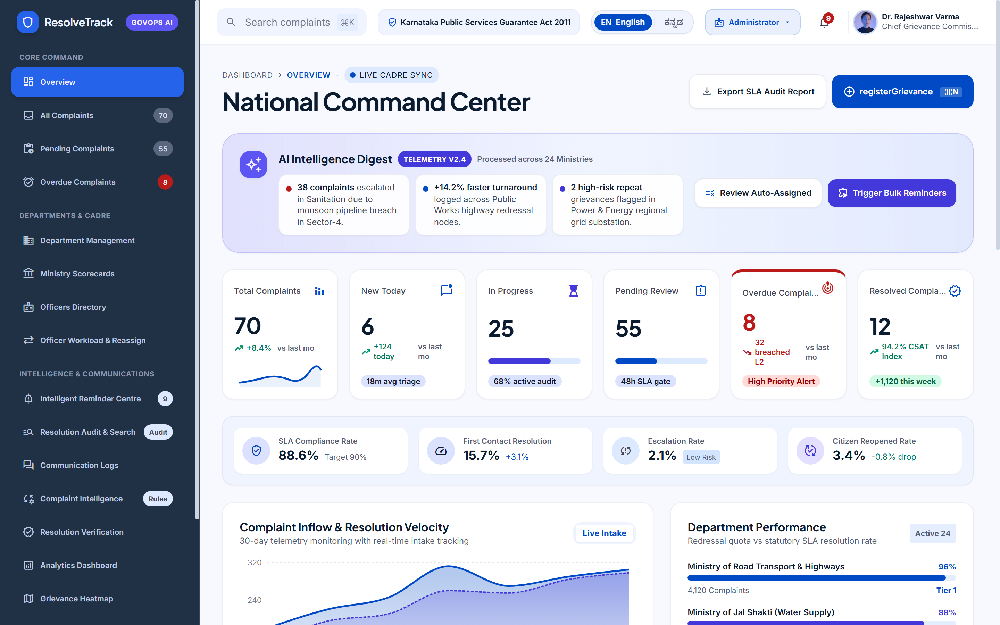
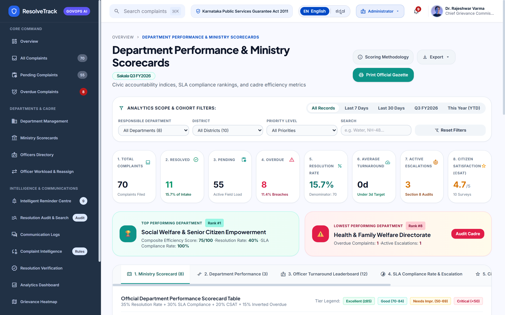
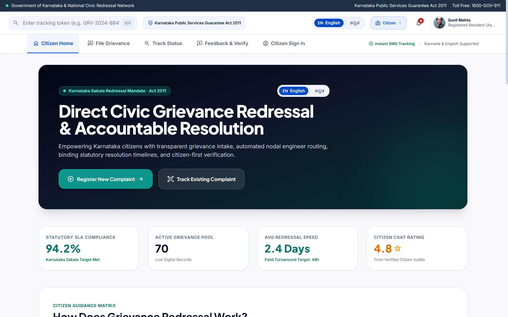
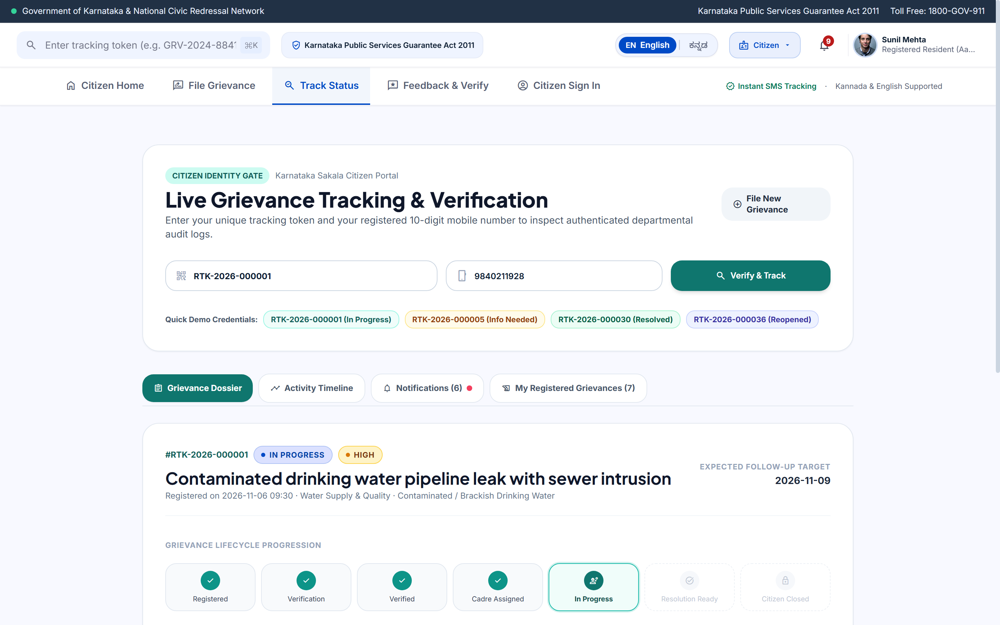
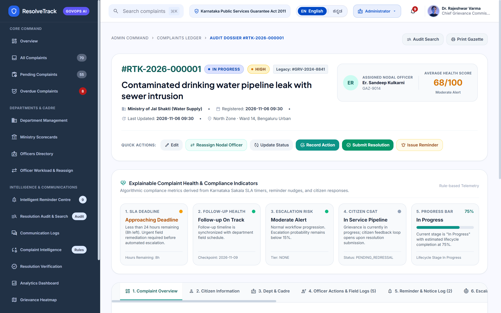
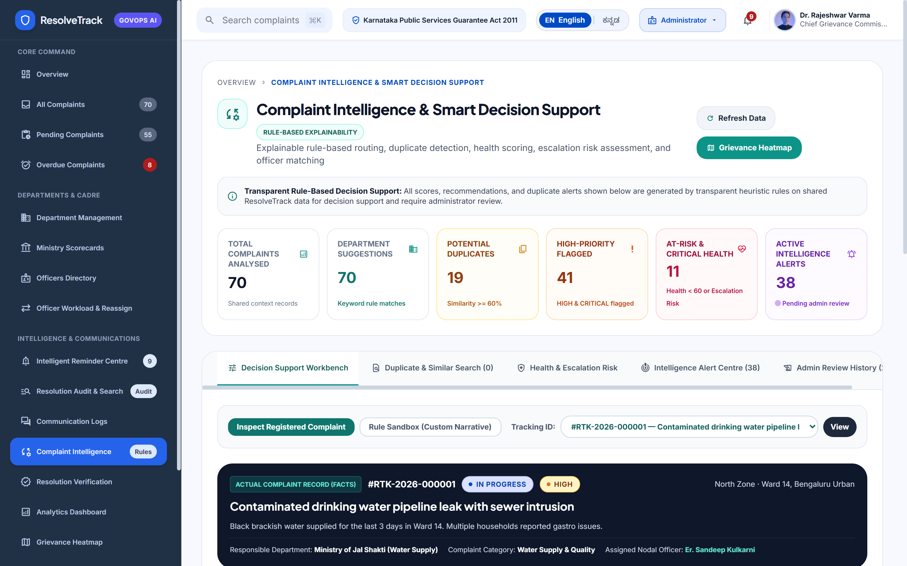
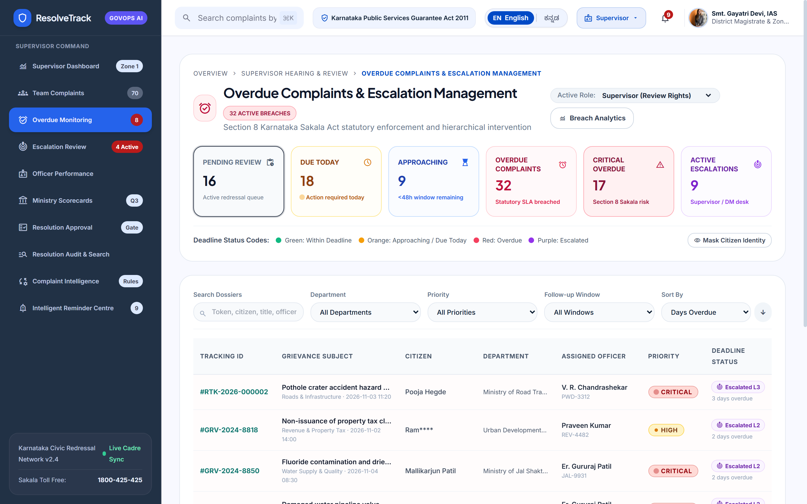

# NammaSafe (ResolveTrack) · Civic Grievance Redressal & Cadre Accountability Platform

[](https://nammasafe-civic.netlify.app)
[](https://github.com/Nagesh-Shimpi/NammaSafe)
[](https://reactjs.org/)
[](https://vitejs.dev/)
[](https://tailwindcss.com/)
[](LICENSE)

> **Live Deployed Prototype:** [https://nammasafe-civic.netlify.app](https://nammasafe-civic.netlify.app)  
> **Built for:** **Solvathon 2026** (organized by **KrishiKalpa Foundation**)  
> **Institution:** **Poojya Doddappa Appa College of Engineering (PDA College), Kalaburagi**  
> **Developer:** [Nagesh Shimpi](https://github.com/Nagesh-Shimpi)

---

## 🎯 Why NammaSafe (ResolveTrack)?

Most civic grievance portals only solve **submission**—once a citizen files a complaint, it disappears into an opaque queue:
- Complaints sit unassigned or get routed manually to the wrong department.
- Field officers become overloaded while peers have available capacity.
- Statutory SLA deadlines pass silently without timely reminders or supervisory escalation.
- Tickets are marked **"Closed"** by officers without citizen confirmation of actual ground resolution.
- Regional citizens face language barriers when filing or tracking grievances in Kannada vs. English.

**NammaSafe (ResolveTrack)** solves the entire post-submission accountability loop. Engineered around the **Karnataka Sakala (Guarantee of Services to Citizens) Act, 2011**, it connects **Citizens, Department Officers, Supervisors, and Administrators** in one transparent, SLA-enforced workflow with **citizen-verified closure**.

---

## 🚀 Quick Demo Walkthrough (For Recruiters & Evaluators)

Open the live application at **[https://nammasafe-civic.netlify.app](https://nammasafe-civic.netlify.app)** — no backend setup or login wall required:

1. **Switch Roles Anytime:** Use the **Role Switcher** in the top navigation bar to explore all 4 portals:
   - **Citizen** (`/citizen`) — Bilingual portal, 4-section grievance registration, dual-factor tracking, 4-criteria CSAT & reopen workflow.
   - **Department Officer** (`/officer/dashboard`) — Assigned field queue, status updates, inspection proof & follow-up logs.
   - **Supervisor** (`/supervisor/overdue-monitoring`) — Section 8 Sakala SLA breach monitoring, L1–L3 escalations, and omnichannel reminder centre.
   - **Administrator** (`/admin/overview`) — National Command Center, 11-tab audit dossier, smart triage workbench, and ministry scorecards.
2. **Try Instant Citizen Tracking:** Visit `/citizen/track` and click any of the **Quick Demo Credentials** pills (`RTK-2026-000001` In Progress, `RTK-2026-000005` Info Needed, `RTK-2026-000030` Resolved, `RTK-2026-000036` Reopened) or enter `RTK-2026-000001` with mobile `9840211928`.
3. **Toggle English ↔ ಕನ್ನಡ (Kannada):** Click the language switcher in the header to switch the entire interface (`270+` paired keys & `47` Karnataka civic glossary terms) instantaneously.
4. **Inspect Explainable Intelligence:** Open `/admin/complaint-intelligence` to test keyword routing, Kannada/English script detection, duplicate similarity checks, and health scoring—all running deterministically with zero external AI API dependencies.

---

## 📸 Platform Screenshots

### 1. National Command Center & Ministry Scorecards
| National Command Center (`/admin/overview`) | Department Performance & Scorecards (`/admin/ministry-scorecards`) |
|---|---|
|  |  |

### 2. Bilingual Citizen Portal & 7-Stage Tracking
| Citizen Home (`/citizen`) | Live Tracking & Verification (`/citizen/track`) |
|---|---|
|  |  |

### 3. Audit Dossier, Explainable Triage & SLA Escalation Desk
| 11-Tab Complaint Audit Dossier (`/admin/complaints/GRV-2024-8841`) | Rule-Based Complaint Intelligence (`/admin/complaint-intelligence`) |
|---|---|
|  |  |

| Supervisor Overdue & L1–L3 Escalations (`/supervisor/overdue-monitoring`) |
|---|
|  |

---

## 🏛️ System Architecture & Core Modules

```text
┌────────────────────────────────────────────────────────────────────────────────────────┐
│                                 NammaSafe Architecture                                 │
├──────────────────────────┬──────────────────────────────┬──────────────────────────────┤
│  1. Citizen Intake       │  2. Workload & Reassignment  │  3. Overdue & Escalation     │
│  - 4-Section Registration│  - Cadre Capacity Gauges     │  - SLA Breach Monitoring     │
│  - Dynamic Civic Sectors │  - Overload Warning Triggers │  - Level 1–3 Escalations     │
│  - GPS & File Attachment │  - 4-Step Reassignment Modal │  - Statutory Penalty Ledger  │
├──────────────────────────┼──────────────────────────────┼──────────────────────────────┤
│  4. Reminder Centre      │  5. Citizen Tracking & CSAT  │  6. Resolution Audit Dossier │
│  - Omnichannel Dispatch  │  - Token + Mobile Auth Gate  │  - 11-Tab Dossier Inspector  │
│  - Bilingual Templates   │  - 7-Stage Visual Lifecycle  │  - Immutable Audit Gazette   │
│  - Fallback Retry Queue  │  - 4-Criteria CSAT & Reopen  │  - Explainable Health Scores │
├──────────────────────────┴──────────────────────────────┴──────────────────────────────┤
│  7. Department Performance, Explainable Intelligence & Police Pilot Track              │
│  - Weighted Composite Ranking (35% Res + 30% SLA + 20% CSAT + 15% Inverted Overdue)    │
│  - Zero-API Rule Engine (Routing, Kannada Script Detection, Duplicate & Risk Scoring)  │
│  - Police & Public Safety Pilot (Non-FIR Civic Tracking with Statutory Boundaries)     │
└────────────────────────────────────────────────────────────────────────────────────────┘
```

### Key Implemented Capabilities

1. **Citizen Registration & Dual-Factor Tracking (`/citizen/register`, `/citizen/track`)**
   - 4-section grievance registration across **10 Karnataka districts** (auto-syncing taluks, wards, PIN codes) and **24 specialized grievance categories** across **8 departments** (`MORTH`, `JAL`, `URBAN/BBMP`, `POWER`, `PDS`, `WELFARE`, `HEALTH`, `POLICE`).
   - Canonical sequential tokens (`RTK-2026-XXXXXX`) with dual-factor verification (Token + 10-digit mobile), 7-stage visual stepper, and an **Additional Information** response flow.
   - **Citizen Verification Gate:** Officers cannot finalize closure unilaterally. Citizens inspect resolution proof and either **Confirm Resolution** (with 4-criteria CSAT: *Overall, Quality, Responsiveness, Timeliness*, plus anonymous mode) or **Request Further Action (Reopen)** with photo proof while preserving the original token.

2. **Explainable Complaint Intelligence (`/admin/complaint-intelligence`)**
   - Deterministic, zero-API heuristic engine (`src/utils/intelligenceEngine.js`) providing transparent Department/Category/Priority suggestions, Duplicate & Similar ticket matching, 0–100 Complaint Health Scores, Escalation Risk queues, and Officer Suitability rankings.
   - **Human-in-the-Loop Governance:** Recommendations never auto-mutate records; administrators review, accept, or override with a full decision audit log.

3. **Officer Workload Balancing & 4-Step Guided Reassignment (`/admin/officer-workload`)**
   - Tracks caseload capacity across **24 nodal officers** (*Available Capacity, Balanced, High Workload, Overloaded*) and enforces a 4-step supervisor-approved reassignment workflow.

4. **Overdue Escalations & Intelligent Reminder Centre (`/supervisor/overdue-monitoring`, `/supervisor/reminder-centre`)**
   - Monitors 24h/48h/72h/96h SLAs, triggers **Level 1 → Level 2 → Level 3** hierarchical escalations, calculates **Section 8 Karnataka Sakala** statutory liability exposure, and simulates bilingual **SMS, Email, WhatsApp, and IVR** dispatches with retry queues.

5. **11-Tab Complaint Audit Dossier & Ministry Scorecards (`/admin/complaints/:id`, `/admin/ministry-scorecards`)**
   - Complete 11-tab dossier (*Overview, Citizen Info, Dept & Cadre, Officer Actions, Reminders, Escalations, Communications, Resolution & CSAT, Complete Timeline, Audit Gazette, Document Vault*) with explainable health cards and printable gazette output.
   - Weighted Department Scorecards (`35% Resolution Rate + 30% SLA Compliance + 20% CSAT + 15% Inverted Overdue`), side-by-side 2–5 department Recharts benchmarking, and 1-click CSV exports.

6. **Bilingual English / Kannada Support + Script Detection (`src/i18n/`, `src/utils/languageDetector.js`)**
   - Full UI translation (`270+` paired keys, `47` civic glossary terms, `Noto Sans Kannada`), bilingual notification templates, and automatic detection of English, Kannada (`\u0C80-\u0CFF`), or Mixed text with side-by-side keyword summaries for officers.

7. **Police Department & Public Safety Pilot (`dept-8`, Solvathon 2026 Track)**
   - Dedicated public-safety grievance tracking (`RTK-2026-000062`–`000066`) covering cybercrime/online fraud, financial fraud, lost property, traffic/public safety, and non-cognizable reports—paired with prominent statutory banners clarifying **non-FIR tracking-only boundaries**.

8. **RBAC Guards, PII Masking & Reload-Safe Persistence**
   - `RoleGuard` route & mutation protection across `/admin/*`, `/supervisor/*`, and `/officer/*`.
   - Automatic phone/Aadhaar masking (`+91 98402 •••• 1928`) and suppression of internal confidential notes from citizen timelines.
   - Client-side persistence via `localStorage` (`resolvetrack_demo_state_v2`) with one-click reset in `/admin/settings`.

---

## 🛠️ Technology Stack

| Layer | Technologies |
|---|---|
| **Frontend** | React `18.3` (Hooks, Context API), React Router `6.28` |
| **Build Tool** | Vite `5.4` |
| **Styling & Design** | Tailwind CSS `3.4`, Google Material Symbols, Plus Jakarta Sans, Inter, Noto Sans Kannada, JetBrains Mono |
| **Data Visualization** | Recharts `2.13`, Lucide React `0.460` |
| **Intelligence & i18n** | Custom deterministic rule engine (`intelligenceEngine.js`), Kannada script detector (`languageDetector.js`), bilingual dictionary (`270+` keys) |
| **State & Hosting** | Unified `ComplaintContext` + `localStorage` persistence (`66` seed dockets), deployed on **Netlify** |

---

## 🗺️ Application Routes

| Route | Role | Key Functionality |
|---|---|---|
| `/citizen` | Citizen | Bilingual civic portal, Sakala metrics, sector directory, FAQs & helplines |
| `/citizen/register` | Citizen | 4-section grievance intake form with auto-generated `RTK-2026-XXXXXX` token |
| `/citizen/track` | Citizen | Dual-factor verification gate, 7-stage stepper, notifications & CSAT/Reopen |
| `/citizen/feedback/:id` | Citizen | Dedicated 4-criteria CSAT rating & dispute reopening flow |
| `/admin/overview` | Administrator | National Command Center with inflow velocity & department telemetry |
| `/admin/all-complaints` | Administrator | Central complaint ledger with KPI cards, filters & dossier links |
| `/admin/complaints/:id` | Admin / Officer / Supervisor | 11-tab audit dossier with explainable health & compliance indicators |
| `/admin/complaint-intelligence` | Administrator | Rule-based routing, duplicate detection, health risk & review history |
| `/admin/ministry-scorecards` | Administrator | Weighted composite department scorecards, comparison charts & CSV export |
| `/admin/officer-workload` | Administrator / Supervisor | Cadre workload gauges & 4-step guided nodal reassignment |
| `/admin/complaint-audit` | Administrator / Supervisor | Multi-dimensional audit search with filters, sorting & pagination |
| `/supervisor/overdue-monitoring` | Supervisor | Overdue SLA breaches, L1–L3 escalations & Section 8 penalty ledger |
| `/supervisor/reminder-centre` | Supervisor | Omnichannel reminder scheduler, bilingual templates & retry queue |
| `/officer/dashboard` | Department Officer | Nodal officer caseload dashboard, status updates & field action logs |

---

## 💻 Local Setup & Installation

```bash
# 1. Clone the repository
git clone https://github.com/Nagesh-Shimpi/NammaSafe.git
cd NammaSafe

# 2. Install dependencies
npm install

# 3. Start local development server
npm run dev

# 4. Build for production
npm run build
```

---

## 🔒 Compliance & Data Governance Highlights

- **Strict State Machine:** `NEWLY_REGISTERED` → `PENDING_VERIFICATION` → `VERIFIED` → `ASSIGNED` → `IN_PROGRESS` → `RESOLVED` → `CLOSED` / `REOPENED`
- **Immutable Tracking Tokens:** Reopening or requesting info preserves the original `RTK-2026-XXXXXX` token.
- **Tamper-Evident Audit Gazette:** Append-only lifecycle log distinguishing certified actions from simulated dispatches.
- **Statutory Police Boundary:** Explicit non-FIR advisory ensuring legal allegations and FIR decisions remain strictly with authorized Police officials.

---

## 👤 Author & Links

- **Live Demo:** [https://nammasafe-civic.netlify.app](https://nammasafe-civic.netlify.app)
- **GitHub Repository:** [https://github.com/Nagesh-Shimpi/NammaSafe](https://github.com/Nagesh-Shimpi/NammaSafe)
- **GitHub Profile:** [https://github.com/Nagesh-Shimpi](https://github.com/Nagesh-Shimpi)
- **License:** MIT License
